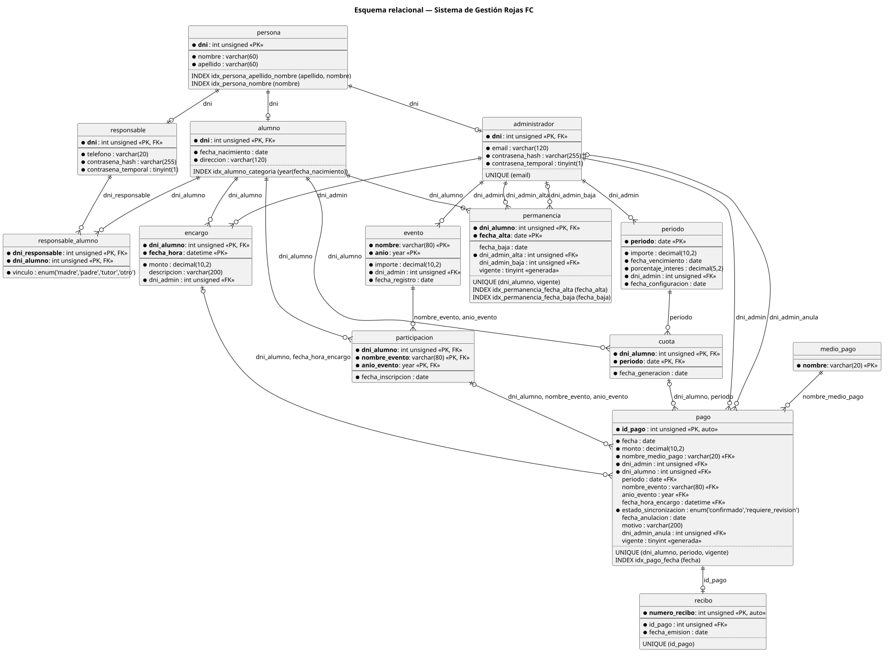

# Diagrama del esquema relacional

## Sistema de Gestión Rojas FC

> Representa las tablas de `database/schema.sql` con sus columnas, tipos de datos, claves primarias y foráneas, restricciones `UNIQUE`, índices y relaciones. Complementa al DER conceptual ([`entidades-relaciones-cardinalidad/`](../entidades-relaciones-cardinalidad/)), que muestra el modelo del negocio en notación de Chen.

| Código | Imagen |
|---|---|
| [esquema-relacional.puml](esquema-relacional.puml) | [esquema-relacional.svg](img/esquema-relacional.svg) |



---

## Notación

| Símbolo | Significado |
|---|---|
| ● antes de la columna | Obligatoria (`NOT NULL`) |
| Nombre en negrita | Parte de la clave primaria |
| «PK» / «FK» | Clave primaria / clave foránea |
| «auto» | Valor asignado por el sistema (`AUTO_INCREMENT`) |
| «generada» | Columna generada a partir de otras de la misma fila |
| `UNIQUE (...)` | Restricción de unicidad |
| `INDEX ... (...)` | Índice agregado para consultas ([indices.md](indices.md)) |
| `\|\|` | Exactamente uno |
| `\|o` | Cero o uno |
| `o{` | Cero o muchos |
| Texto sobre la línea | Columnas de la clave foránea |

---

## Aclaraciones

- **Índices.** MySQL crea además un índice por cada clave primaria y cada clave foránea. El diagrama muestra solo las restricciones `UNIQUE` y los índices agregados en la sección 10 de `schema.sql`, cuya justificación está en [indices.md](indices.md).
- **Tipos.** `tinyint(1)` es el tipo con el que MySQL guarda las columnas declaradas `BOOLEAN`.
- **Pagos.** Las tres claves foráneas de `pago` hacia `cuota`, `participacion` y `encargo` son opcionales, porque cada pago se imputa a una sola de esas obligaciones (RN-25).
- **Lo que no se dibuja.** Las restricciones `CHECK`, los triggers y las vistas están en `schema.sql` y se explican en [claves-restricciones.md](claves-restricciones.md).

El diagrama se generó a partir de la estructura que crea `schema.sql` en MySQL 8.4, así que coincide con el script. Si el esquema cambia, hay que actualizar `esquema-relacional.puml` y volver a generar la imagen:

```bash
java -jar plantuml.jar -tsvg -o img esquema-relacional.puml
```
